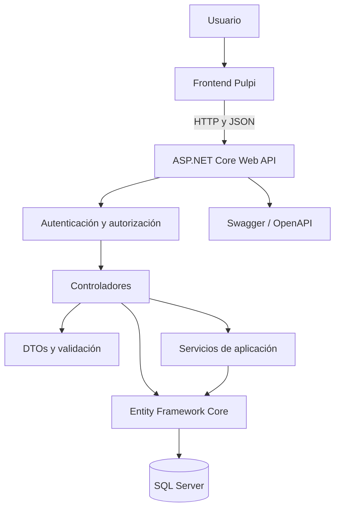
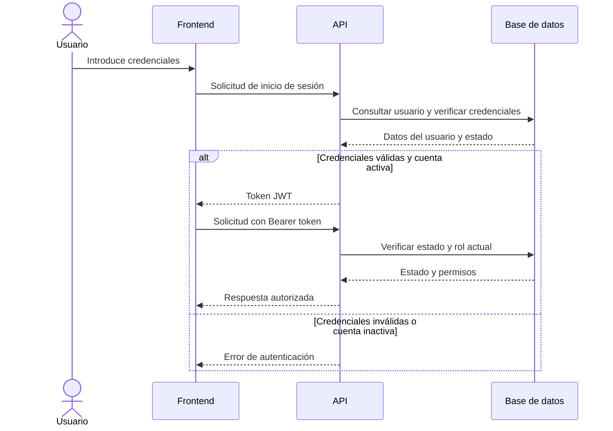
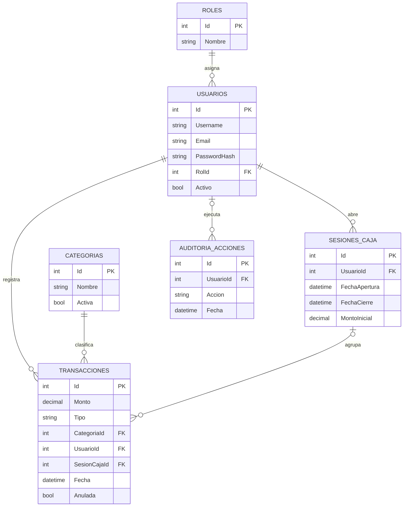
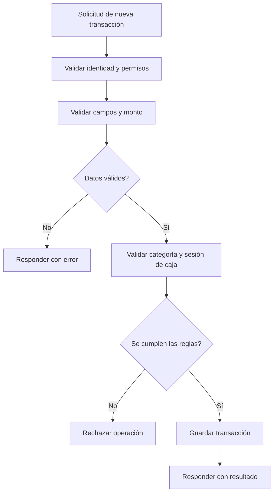
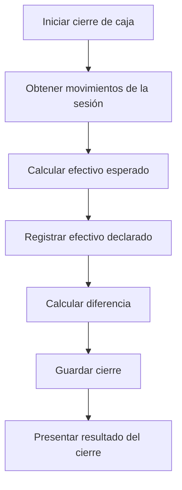

# Pulpi API — Backend RESTful

API REST del sistema **Pulpi**, desarrollada para administrar usuarios, categorías, transacciones financieras y sesiones de caja. El backend centraliza las reglas de negocio, la autenticación, la autorización y la persistencia de los datos.

## Funcionalidades principales

### Autenticación y usuarios
- Registro de usuarios e inicio de sesión.
- Protección de contraseñas mediante hash con BCrypt.
- Autenticación mediante tokens JWT.
- Gestión de roles: `Administrador` y `Cajero`.
- Validación de identidad, estado de la cuenta y permisos.

### Categorías
- Consulta y administración de categorías.
- Clasificación de ingresos y gastos.
- Protección del historial al gestionar categorías relacionadas con transacciones.

### Transacciones financieras
- Registro de ingresos y gastos.
- Asociación de movimientos con usuarios, categorías y sesiones de caja.
- Validación de los datos recibidos por la API.
- Anulación lógica de transacciones para conservar el historial.

### Sesiones de caja
- Apertura y cierre de caja.
- Registro de movimientos asociados a una sesión.
- Cálculo del efectivo esperado.
- Comparación del efectivo esperado con el declarado al cierre.

### Balances y reportes
- Consulta de información financiera.
- Restricción de balances y reportes globales a usuarios autorizados.
- Separación de los permisos administrativos y operativos.

### Auditoría
- Registro de acciones relevantes.
- Trazabilidad de operaciones financieras y administrativas contempladas por la API.
- Conservación del historial mediante mecanismos de anulación lógica.

## Tecnologías

| Tecnología | Función |
|---|---|
| C# y .NET 10 | Plataforma de desarrollo |
| ASP.NET Core Web API | Creación de endpoints REST |
| Entity Framework Core | Acceso y persistencia de datos |
| SQL Server | Base de datos relacional |
| JWT Bearer | Autenticación |
| BCrypt.Net-Next | Protección de contraseñas |
| Swagger / OpenAPI | Documentación y pruebas de endpoints |
| Mermaid | Diagramas de arquitectura y procesos |

## Objetivo del proyecto

Pulpi busca centralizar el registro de movimientos financieros y el control de caja mediante una API REST que permita integrar el frontend con una base de datos, aplicando reglas de negocio y permisos desde el servidor.

## Arquitectura del sistema

Pulpi utiliza una arquitectura cliente-servidor. El frontend envía solicitudes HTTP a la API, que valida las solicitudes, aplica las reglas de negocio y consulta o modifica la información almacenada en SQL Server.

### Flujo de autenticación

### Modelo de datos

Las principales entidades del sistema representan usuarios, roles, categorías, transacciones, sesiones de caja y acciones de auditoría.

Este diagrama es conceptual: los nombres, campos y relaciones deben contrastarse con las entidades y migraciones reales del proyecto.

### Roles y permisos

| Funcionalidad | Administrador | Cajero |
|---|---|---|
| Gestión de usuarios y roles | Permitida según endpoint | Restringida |
| Administración de categorías | Según endpoint | Según endpoint |
| Registro de transacciones | Permitido según reglas | Permitido según reglas |
| Consulta de transacciones | Según alcance autorizado | Limitada a sus datos |
| Apertura y cierre de caja | Según reglas | Según reglas |
| Balances globales y reportes | Acceso autorizado | Restringido |
| Consulta de auditoría | Según permisos | Restringida |

La autorización debe comprobarse en el backend. La interfaz gráfica no debe considerarse un mecanismo de seguridad.

### Flujo de registro de una transacción

### Flujo de cierre de caja

El cálculo definitivo del efectivo esperado debe seguir la fórmula implementada en el backend, considerando el saldo inicial y los movimientos que afectan al efectivo.