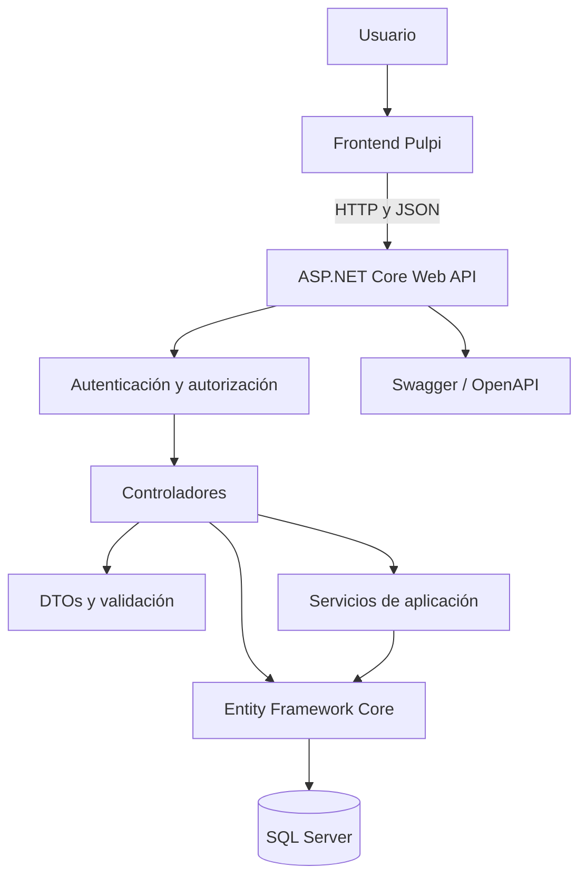
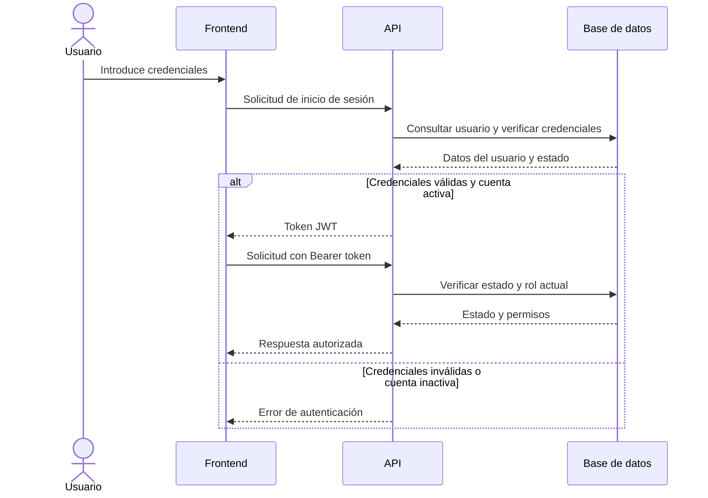
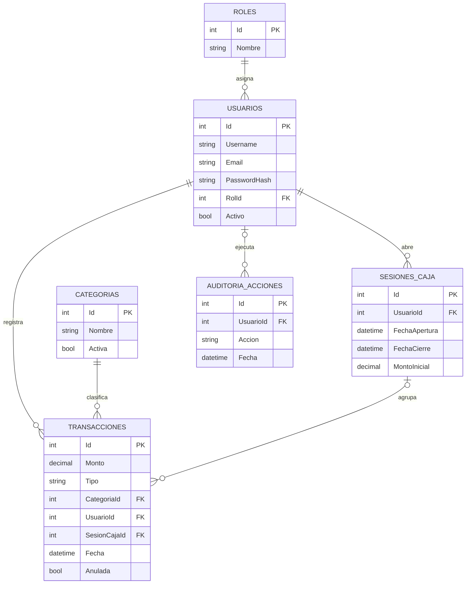
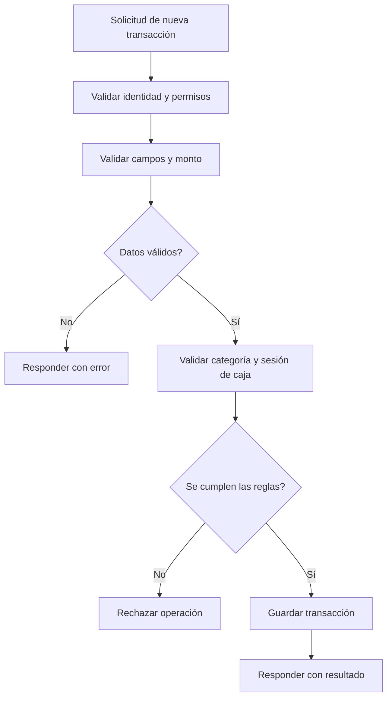
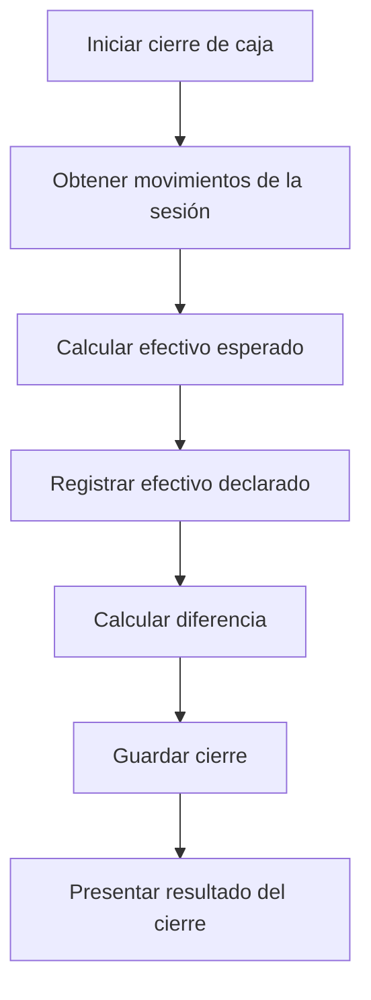

# Pulpi API — Backend RESTful

API REST del sistema **Pulpi**, desarrollada para administrar usuarios, categorías, transacciones financieras y sesiones de caja. El backend centraliza las reglas de negocio, la autenticación, la autorización y la persistencia de los datos.

## Funcionalidades principales

### Autenticación y usuarios
- Registro de usuarios e inicio de sesión.
- Protección de contraseñas mediante hash con BCrypt.
- Autenticación mediante tokens JWT.
- Gestión de roles: `Administrador` y `Cajero`.
- Validación de identidad, estado de la cuenta y permisos.

### Categorías
- Consulta y administración de categorías.
- Clasificación de ingresos y gastos.
- Protección del historial al gestionar categorías relacionadas con transacciones.

### Transacciones financieras
- Registro de ingresos y gastos.
- Asociación de movimientos con usuarios, categorías y sesiones de caja.
- Validación de los datos recibidos por la API.
- Anulación lógica de transacciones para conservar el historial.

### Sesiones de caja
- Apertura y cierre de caja.
- Registro de movimientos asociados a una sesión.
- Cálculo del efectivo esperado.
- Comparación del efectivo esperado con el declarado al cierre.

### Balances y reportes
- Consulta de información financiera.
- Restricción de balances y reportes globales a usuarios autorizados.
- Separación de los permisos administrativos y operativos.

### Auditoría
- Registro de acciones relevantes.
- Trazabilidad de operaciones financieras y administrativas contempladas por la API.
- Conservación del historial mediante mecanismos de anulación lógica.

## Tecnologías

| Tecnología | Función |
|---|---|
| C# y .NET 10 | Plataforma de desarrollo |
| ASP.NET Core Web API | Creación de endpoints REST |
| Entity Framework Core | Acceso y persistencia de datos |
| SQL Server | Base de datos relacional |
| JWT Bearer | Autenticación |
| BCrypt.Net-Next | Protección de contraseñas |
| Swagger / OpenAPI | Documentación y pruebas de endpoints |
| Mermaid | Diagramas de arquitectura y procesos |

## Objetivo del proyecto

Pulpi busca centralizar el registro de movimientos financieros y el control de caja mediante una API REST que permita integrar el frontend con una base de datos, aplicando reglas de negocio y permisos desde el servidor.

## Arquitectura del sistema

Pulpi utiliza una arquitectura cliente-servidor. El frontend envía solicitudes HTTP a la API, que valida las solicitudes, aplica las reglas de negocio y consulta o modifica la información almacenada en SQL Server.



### Flujo de autenticación



### Modelo de datos

Las principales entidades del sistema representan usuarios, roles, categorías, transacciones, sesiones de caja y acciones de auditoría.



Este diagrama es conceptual: los nombres, campos y relaciones deben contrastarse con las entidades y migraciones reales del proyecto.

### Roles y permisos

| Funcionalidad | Administrador | Cajero |
|---|---|---|
| Gestión de usuarios y roles | Permitida según endpoint | Restringida |
| Administración de categorías | Según endpoint | Según endpoint |
| Registro de transacciones | Permitido según reglas | Permitido según reglas |
| Consulta de transacciones | Según alcance autorizado | Limitada a sus datos |
| Apertura y cierre de caja | Según reglas | Según reglas |
| Balances globales y reportes | Acceso autorizado | Restringido |
| Consulta de auditoría | Según permisos | Restringida |

La autorización debe comprobarse en el backend. La interfaz gráfica no debe considerarse un mecanismo de seguridad.

### Flujo de registro de una transacción



### Flujo de cierre de caja



El cálculo definitivo del efectivo esperado debe seguir la fórmula implementada en el backend, considerando el saldo inicial y los movimientos que afectan al efectivo.

## Requisitos previos

Antes de ejecutar Pulpi, verifica que tengas instalado:

- .NET SDK compatible con .NET 10.
- SQL Server.
- Git.
- Un editor de código, como Visual Studio o Visual Studio Code.

## Instalación

### 1. Clonar el repositorio

```bash
git clone https://github.com/angelbarreto46u/webapi-restful-backend-pulpi.git
cd webapi-restful-backend-pulpi
```

### 2. Restaurar dependencias

```bash
dotnet restore
```

### 3. Configurar la conexión a SQL Server

Configura la cadena de conexión `ConnectionStrings:DefaultConnection` de acuerdo con tu instancia de SQL Server.

No publiques contraseñas ni credenciales reales en el repositorio. Para el entorno de desarrollo, puedes utilizar User Secrets o variables de entorno.

### 4. Configurar JWT

La API necesita una clave secreta para firmar los tokens JWT. Utiliza una clave aleatoria segura de al menos 32 bytes y mantenla fuera del control de versiones.

Si el proyecto utiliza la configuración `Jwt:Key`, `Jwt:Issuer` y `Jwt:Audience`, puedes definir los valores mediante User Secrets:

```bash
dotnet user-secrets init
dotnet user-secrets set "Jwt:Key" "REEMPLAZAR_POR_UN_SECRETO_SEGURO"
dotnet user-secrets set "Jwt:Issuer" "Pulpi"
dotnet user-secrets set "Jwt:Audience" "PulpiFrontend"
```

Los valores del emisor y de la audiencia deben coincidir con los configurados en la aplicación. No utilices literalmente los valores de ejemplo sin verificar la configuración del proyecto.

### 5. Aplicar las migraciones

Antes de ejecutar migraciones sobre una base de datos que contenga información importante, realiza un respaldo.

Si el proyecto utiliza Entity Framework Core y las migraciones están configuradas:

```bash
dotnet ef database update
```

Si el comando `dotnet ef` no está disponible, instala una versión compatible con la versión de Entity Framework Core utilizada por el proyecto.

**Advertencia:** revisa las migraciones antes de aplicarlas. Una migración que elimina tablas o columnas puede provocar pérdida de información.

### 6. Ejecutar el backend

```bash
dotnet run
```

Consulta la consola y `Properties/launchSettings.json` para identificar el puerto y el protocolo configurados.

## Swagger / OpenAPI

Swagger permite consultar los endpoints publicados por la API, revisar sus parámetros y probar solicitudes.

Si la documentación está habilitada en el entorno de desarrollo, accede a la ruta `/swagger` de la URL indicada por la aplicación.

### Probar endpoints protegidos

1. Ejecuta el endpoint de inicio de sesión.
2. Obtén el token JWT de la respuesta.
3. Abre el mecanismo de autorización de Swagger.
4. Introduce el token según el esquema Bearer configurado.
5. Ejecuta el endpoint que deseas probar.

Los endpoints públicos deben funcionar sin autenticación. Los endpoints protegidos deben validar el token y los permisos correspondientes.

## Ejemplo de solicitud autenticada

```http
GET /api/Auth/me HTTP/1.1
Host: localhost:5266
Authorization: Bearer <TOKEN_JWT>
Accept: application/json
```

Ejemplo equivalente con `curl`:

```bash
curl -X GET "http://localhost:5266/api/Auth/me" \
  -H "Authorization: Bearer <TOKEN_JWT>" \
  -H "Accept: application/json"
```

El endpoint y el puerto anteriores son ejemplos que debes contrastar con las rutas y la configuración reales del proyecto.

## Integración con el frontend

El frontend de Pulpi debe enviar solicitudes HTTP a la URL base de la API.

Para integrar ambos proyectos:

- Configura la URL base del backend en el frontend.
- Envía los datos en el formato definido por los DTOs.
- Incluye el token JWT en las solicitudes protegidas.
- Gestiona las respuestas de validación y los códigos HTTP.
- Configura CORS para autorizar el origen del frontend.
- No confíes en el frontend para aplicar permisos de seguridad.

## Migraciones y datos existentes

Antes de actualizar el esquema:

1. Revisa las migraciones pendientes.
2. Identifica operaciones destructivas.
3. Crea un respaldo de la base de datos.
4. Aplica los cambios en un entorno de desarrollo.
5. Verifica las tablas y las operaciones principales antes de actualizar producción.

## Seguridad

Pulpi debe aplicar controles de seguridad en el backend para proteger la información de los usuarios y la integridad de las operaciones financieras.

### Autenticación y autorización
- Utilizar JWT Bearer para autenticar las solicitudes protegidas.
- Validar la firma y la expiración del token.
- Verificar el estado de la cuenta y los permisos necesarios para la operación.
- Restringir el acceso a los recursos según el rol y la propiedad de los datos.
- No permitir que un usuario se otorgue privilegios administrativos mediante el registro público.

### Protección de credenciales
- Almacenar contraseñas mediante un algoritmo de hash seguro, como BCrypt.
- No almacenar contraseñas en texto plano.
- Mantener las claves JWT y las credenciales de la base de datos fuera del repositorio.
- Utilizar HTTPS en entornos distintos del desarrollo local.

### Integridad financiera
- Validar los montos y los datos recibidos por la API.
- Comprobar que la sesión de caja esté abierta cuando la operación lo requiera.
- Evitar modificaciones no autorizadas de transacciones.
- Conservar la trazabilidad de los movimientos anulados.
- Registrar las operaciones administrativas relevantes.

## Auditoría

El sistema contempla un registro de acciones para facilitar la trazabilidad de operaciones relevantes.

La auditoría permite investigar qué acción se ejecutó, cuándo ocurrió y qué usuario la realizó, siempre que esos datos estén registrados por la implementación.

Los registros de auditoría deben protegerse contra modificaciones no autorizadas y no deben utilizarse para almacenar contraseñas, tokens completos ni otros secretos.

## Control de caja

El flujo operativo de caja comprende la apertura de una sesión, el registro de movimientos y el cierre.

### Apertura
1. Validar la identidad y los permisos del usuario.
2. Comprobar las reglas para iniciar una nueva sesión.
3. Registrar el monto inicial y la fecha de apertura.
4. Asociar los movimientos posteriores con la sesión correspondiente.

### Operación
1. Validar cada movimiento.
2. Verificar la categoría y la sesión aplicable.
3. Registrar la transacción y su relación con el usuario.
4. Mantener la consistencia de los datos financieros.

### Cierre
1. Recuperar los movimientos que afectan al efectivo.
2. Calcular el efectivo esperado según las reglas del sistema.
3. Registrar el efectivo declarado.
4. Calcular y guardar la diferencia, cuando corresponda.
5. Conservar la información necesaria para auditorías posteriores.

## Manejo de errores

La API debe utilizar códigos HTTP apropiados para comunicar el resultado de las solicitudes.

| Código HTTP | Significado |
|---|---|
| `200 OK` | Solicitud procesada correctamente |
| `201 Created` | Recurso creado |
| `400 Bad Request` | Datos inválidos o solicitud incorrecta |
| `401 Unauthorized` | Autenticación ausente o inválida |
| `403 Forbidden` | Usuario autenticado sin permisos suficientes |
| `404 Not Found` | Recurso no encontrado |
| `409 Conflict` | Conflicto con el estado actual del recurso |
| `500 Internal Server Error` | Error inesperado del servidor |

Los códigos concretos dependen de cómo cada controlador gestione sus resultados y excepciones.

## Estructura del proyecto

La organización del repositorio puede consultarse directamente en sus directorios y archivos.

```text
webapi-restful-backend-pulpi/
├── Controllers/
├── DTOs/
├── Data/
├── Migrations/
├── Models/
├── Services/
├── Properties/
├── scripts/
├── Program.cs
├── appsettings.json
└── webapi-restful-backend-pulpi.csproj
```

Descripción general:

- **Controllers:** reciben las solicitudes HTTP y coordinan la ejecución de las operaciones.
- **DTOs:** definen los datos de entrada y salida de la API.
- **Data:** contiene el contexto y la configuración del acceso a datos.
- **Migrations:** registra los cambios versionados del esquema de la base de datos.
- **Models:** representa las entidades del dominio.
- **Services:** agrupa servicios y operaciones de aplicación.
- **Properties:** contiene configuración de ejecución local.
- **scripts:** puede incluir scripts auxiliares para tareas administrativas.
- **Program.cs:** configura los servicios y el pipeline de ASP.NET Core.
- **appsettings.json:** contiene la configuración general de la aplicación.

Esta estructura es descriptiva y debe ajustarse si los directorios reales del repositorio difieren.

## Mantenimiento

Para mantener el proyecto:

- Revisa las dependencias y sus actualizaciones.
- Verifica las migraciones antes de aplicarlas.
- Ejecuta pruebas de autenticación, autorización y operaciones financieras.
- Comprueba la apertura y el cierre de caja.
- Mantén respaldos de la base de datos.
- Revisa los logs y la auditoría ante errores de operación.

## Repositorio

Código fuente: https://github.com/angelbarreto46u/webapi-restful-backend-pulpi

La documentación debe mantenerse alineada con las entidades, los DTOs, los controladores y las reglas de negocio implementadas en el código fuente.